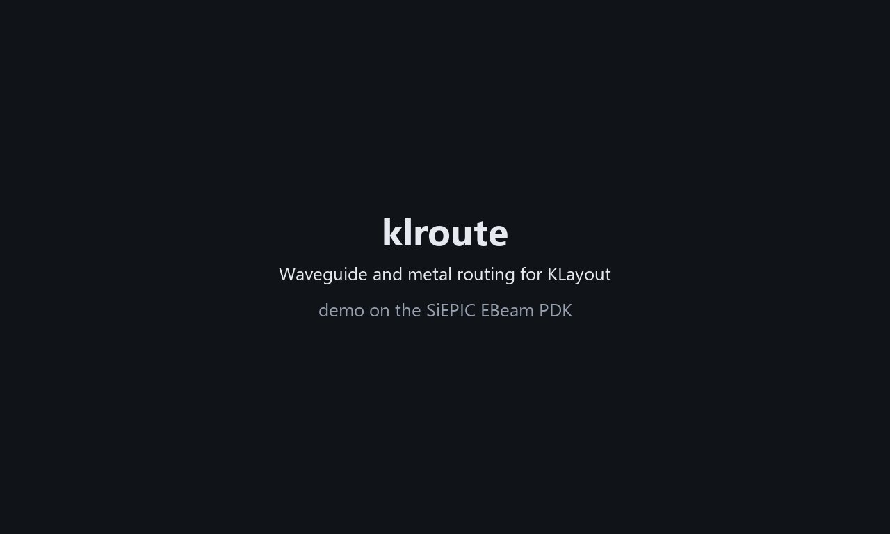

# klroute: waveguide and metal routing for KLayout

klroute routes **waveguides** and **metal** in KLayout for **SiEPIC and SiEPIC-compatible PDKs**.
Click corners like the Path tool, auto-route from A to B around other devices, or click components one after
another and let klroute link them. Routes stay editable.

The full user manual is in [docs/klroute_user_manual.html](docs/klroute_user_manual.html). It also comes with the installed package.

## Demo

A walkthrough on the SiEPIC EBeam PDK: Chain mode builds an MZI, KLayout's Partial tool reshapes an arm, auto-route avoids a device, a metal route changes layer,
Bridge crosses a wire, Add Pins and Attach ([MP4 version with voice-over](docs/klroute_demo.mp4)).



## What it does

* **Waveguides** with circular or Euler bends, or built from the PDK's own bend and straight cells. PDK waveguide types
  are read from the technology's `WAVEGUIDES.xml`, and the PDK's `Waveguide` cell is used where possible.
* **Metal** with square corners, drawn as the PDK's wire cell (e.g. `Wireguide`) or a klroute Route cell. Vias are added
  where a route lands on another metal. A route can change metal along the way (Shift+click or V), and *Bridge* mode lets a wire hop over another one.
* **Auto-route** picks the straight, L, Z, S, U or detour shape that fits the bend radius. With *Route around other devices*
  on, it searches a Manhattan path that keeps clear of other components (DevRec).
* **Chain** links components two at a time, port to port, with a dialog for the ports, waveguide type, bend cell and labels.
* **Attach** puts one component onto another's pin. Attached parts, labels and routes move along.
* **Test structures:** grating couplers at route ends, SiEPIC `opt_in` / `out_` labels, electrical `elec_<ID>_<pad>`
  labels, a device-to-GC-array connector, and a test-coordinate list you can save.
* **Your own devices:** add SiEPIC pins (automatically or by clicking) and a DevRec box.
* **Your own libraries:** select a cell and add it to a library of your own (saved in `<KLayout folder>/klroute_libraries`, loaded at startup); PDK cells and PCells inside it stay library references.
* **SiEPIC verification:** routes are SiEPIC components (pins, DevRec, compact-model texts), and the PDK's DFT rules
  (`DFT.xml`) are followed for grating couplers.

## Install

klroute is a KLayout **Salt package**. On this computer:

```bash
python install.py
```

This copies the package to `~/KLayout/salt/klroute` (`%USERPROFILE%\KLayout\salt\klroute` on Windows). Restart KLayout.
`python install.py --uninstall` removes it.

To share it:

```bash
python install.py --zip
```

This builds `dist/klroute-<version>.zip`. On another computer, unzip it into the KLayout `salt` folder so that
`.../KLayout/salt/klroute/grain.xml` exists, then restart KLayout.

Requirements: KLayout 0.28 or newer, a SiEPIC-compatible PDK installed as a technology, and SiEPIC-Tools.

## Use

| Window | Tool | Shortcut |
|---|---|---|
| **Waveguide Route** | blue S-curve button | Ctrl+Shift+R |
| **Metal Route** | gold S-curve button | Ctrl+Shift+M |

Both are also under **Tools → Route (Waveguide / Metal)**. Pick a **Click mode** in the window:
*Path*, *Auto-route*, *Chain*, *Pin*, *Attach*, *Label*, plus *Bridge* in the Metal Route window. Then click in the layout.
See the manual for every setting.

## Setting it up for your PDK

The built-in settings follow the SiEPIC conventions:

| | Built-in |
|---|---|
| Waveguide core (pin finder) | `Si` 1/0, `SiN` 4/0 |
| Metals | `M2_router` 12/0 (default), `M1_heater` 11/0, and `M1`, `M2`, `M3`, `Metal1`, `Metal2`, `Metal3` if they exist |
| Metal pairs | M2_router ↔ M1_heater as a contact pad, with no cut layer |
| Pins, outlines, labels | `PinRec` 1/10, `PinRecM` 1/11, `DevRec` 68/0, `FbrTgt` 81/0, `Text` 10/0 |
| opt_in label position | the GC tip (SiEPIC rule) |

For a PDK with other layer names, metal stack or via rules, put a file **`klroute_profile.json`** in the PDK's
**technology folder** (the folder with its `.lyt` file). klroute then uses it for every layout of that technology, on every
computer where the PDK is installed with this file. It switches automatically when you work on layouts of different technologies.
A `klroute_profile.json` in your KLayout user folder (`%USERPROFILE%\KLayout` on Windows, `~/.klayout` on Linux/macOS) applies to all
technologies; the technology folder's file wins over it. Their keys replace the built-in ones:

```json
{
  "core": [["Si", "1/0"]],
  "contact_metals": [["M1", "41/0"], ["M2", "45/0"]],
  "metals": ["M1", "M2", "M3"],
  "default_metal": "M1",
  "via_pairs": {"M1": ["M2", "VIA1"], "M2": ["M1", "VIA1"]},
  "via_cuts": [["M1", "M2", "VIA1"], ["M2", "M3", "VIA2"]],
  "default_cut": "VIA1",
  "via_unit": 5.0, "via_cut": 0.8, "via_pitch": 1.4, "via_enclosure": 0.7,
  "label_at": "fiber"
}
```

These files belong to the PDK (or to you), not to klroute: they are never part of the package. `python install.py --zip`
refuses to build the zip if a layer or metal name from any of them appears in the package's files.

## Use from a script

```python
from klroute import RouteSpec, draw_route, route

spec = RouteSpec(kind="waveguide", width=0.5, radius=10, bend="euler", cladding=2)
rt = draw_route(cell, layout.layer(1, 0), (0, 0), (250, 80), spec,
                start_dir="E", end_dir="W", cladding_layer=layout.layer(111, 0))
print(rt.length, rt.bends)

m1 = RouteSpec(kind="metal", width=3)
draw_route(cell, layout.layer(41, 0), (0, 0), (-40, 120), m1)   # auto directions

rt = route((0, 0), (100, 50), spec)   # geometry only: rt.centerline, rt.waypoints, rt.polygon()
```

If no route fits, `route()` raises `RouteError`.

## Files

```
grain.xml                      Salt package description
python/klroute/profile.py      the PDK settings (built-in SiEPIC defaults + your klroute_profile.json)
python/klroute/router.py       routing geometry (no GUI, testable)
python/klroute/gui.py          KLayout tools, windows and menu
python/klroute/pcell.py        "klroute" library with the editable Route PCell
python/klroute/maze.py         routing around obstacles
python/klroute/autoconnect.py  crossing-free GC array for all ports of a device
python/klroute/gc.py           grating couplers, labels, test coordinates
python/klroute/pins.py         SiEPIC pins for your own devices
python/klroute/pdk.py          reads WAVEGUIDES.xml and .lyp layer names
pymacros/klroute_autorun.lym   loads the tool at KLayout startup
docs/klroute_user_manual.html  user manual
tests/test_router.py           python tests/test_router.py
```
